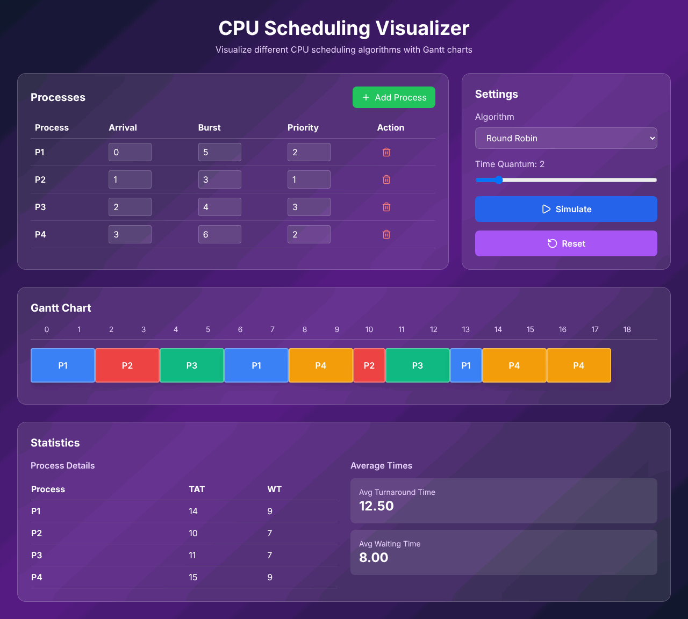

# CPU Scheduling Visualizer

[](https://github.com/SrivArchit/cpu_scheduling_algorithm_visualizer/actions/workflows/ci.yml)

**Live demo:** https://cpuschedulingalgorithmvisualizer.vercel.app

An interactive tool for seeing how operating-system CPU schedulers order processes. Add processes, pick an algorithm, and get the Gantt chart plus waiting and turnaround times for every process.



## Features

- **Six scheduling algorithms**
  - First Come First Serve (FCFS)
  - Shortest Job First, non-preemptive (SJF)
  - Shortest Remaining Time First, preemptive SJF (SRTF)
  - Priority, non-preemptive and preemptive
  - Round Robin with a configurable time quantum
- **Editable process table**: add or remove processes and set each one's arrival time, burst time and priority
- **Gantt chart** showing which process holds the CPU at every time unit
- **Statistics**: turnaround time (TAT) and waiting time for each process, plus the averages

## Tech stack

React 19 · TypeScript · Vite · Tailwind CSS · lucide-react icons

## Run locally

```bash
git clone https://github.com/SrivArchit/cpu_scheduling_algorithm_visualizer.git
cd cpu_scheduling_algorithm_visualizer
npm install
npm run dev
```

Then open the URL Vite prints (usually http://localhost:5173).

## CI and deployment

- Every push and pull request runs [`.github/workflows/ci.yml`](.github/workflows/ci.yml): ESLint, the TypeScript type-check and a production build.
- Vercel redeploys the live demo on every push to `main`.

## Author

**Archit Srivastava** — B.Tech CSE, Manipal University Jaipur

## License

[GPL-3.0](LICENSE)
